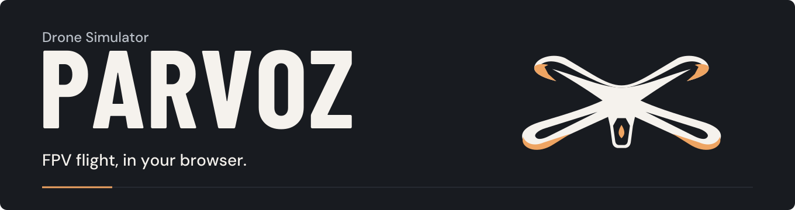

<p align="center">
  <a href="https://parvoz-drone-sim.duckdns.org/">
    
  </a>
</p>

<h1 align="center">Parvoz Drone Simulator</h1>

<p align="center">
  Learn to hover. Find your line. Fly with friends.<br />
  An FPV drone simulator for desktop browsers, with lessons, racing and a workshop.
</p>

<p align="center">
  
</p>

<p align="center">
  <strong><a href="https://parvoz-drone-sim.duckdns.org/">Play the web beta</a></strong>
  &nbsp;·&nbsp; <a href="#screenshots">Screenshots</a>
  &nbsp;·&nbsp; <a href="#quick-start">Quick start</a>
  &nbsp;·&nbsp; <a href="docs/README.md">Documentation</a>
</p>

<p align="center">English &nbsp;|&nbsp; <a href="README.ru.md">Русский</a></p>

---

## Take your first flight

**Parvoz** brings FPV practice to a browser: start with short piloting lessons,
explore a location at your own pace, then try a timed route or a race with friends.
Begin with a keyboard, or calibrate a compatible gamepad or USB radio.
The interface is available in **Uzbek, Russian and English**.

The current test catalog has **5 locations, 30 routes, 5 base drones and 12 lessons**.

| Learn and explore | Race and make it yours |
| --- | --- |
| **Flight school** — practice hovering, altitude, turns and landing through guided lessons. | **Multiplayer** — public or private rooms for 2–8 pilots, room chat and championships. |
| **Free flight and freestyle** — explore airfields, an arena, a parking garage, woodland and countryside. | **Hangar and tuning** — save aircraft copies, choose compatible parts and adjust rates, PID and throttle response. |
| **Flexible controls** — keyboard, Gamepad API and compatible WebHID radios, with calibration and axis mapping. | **Progress and replays** — accounts, career, records, weekly challenges and manually saved flight replays. |

## Screenshots

<table>
  <tr>
    <td width="50%">
      <a href="src/assets/loading/the-green.jpg"></a><br />
      <strong>The Green</strong><br />Open space and outdoor routes.
    </td>
    <td width="50%">
      <a href="docs/design/ui-performance-20261018/19-online-final-hangar.jpg"></a><br />
      <strong>Hangar</strong><br />Inspect your aircraft and select a saved build.
    </td>
  </tr>
  <tr>
    <td width="50%">
      <a href="docs/design/ui-polish-20261015/24-public-workbench.png"></a><br />
      <strong>Workbench</strong><br />Choose compatible hardware and tune your setup.
    </td>
    <td width="50%">
      <a href="docs/design/ui-performance-20261018/09-ru-lessons.jpg"></a><br />
      <strong>Flight school</strong><br />Build skills one exercise at a time.
    </td>
  </tr>
</table>

Actual game captures from development and the web beta. [Capture sources and dates](docs/presentation/README.md).

## Play in your browser

**[Open Parvoz](https://parvoz-drone-sim.duckdns.org/)** on a desktop computer
with a browser that supports WebGPU or WebGL2. No local project setup is needed.

1. Enter as a guest, or sign in to keep account progress across computers.
2. Open **Settings → Controls** to check keyboard bindings or calibrate your device.
3. Choose **Flight school** for a guided exercise, or **Flight** for a location and mode.

Maps and aircraft download when needed. The first visit to a location can take
longer than a repeat visit. Manually saved replays, graphics settings and device
calibration stay in the current browser; account progress is stored on the server.

> **Web beta:** loading reliability and frame pacing are still being improved.
> The server currently admits 20 multiplayer players across all rooms.
> See [release status and known limits](docs/ORACLE-DEPLOYMENT.md).

## Controls at a glance

| Input | Action |
| --- | --- |
| **W / S** · **A / D** · **Q / E** | Pitch · roll · yaw |
| **Left Shift / F** | Increase / decrease throttle |
| **R** | Reset to the last completed race checkpoint |
| **C** | Switch camera |
| **M** | Cycle Angle, Horizon and Acro modes |
| **Esc** | Open the pause menu |

Acro is the default flight mode. Device setup, calibration, WebHID and additional
controls are covered in the [developer and controls guide](docs/DEVELOPMENT.md#controls-and-radios).
Mobile touch flight controls are not included.

## Quick start

For contributors with access to this private repository. Install **Git + Git LFS**,
**Node.js 24+** and a browser with WebGPU or WebGL2.

```powershell
git lfs install
git clone https://github.com/Fayzullo637/ParvozDroneSim.git
cd ParvozDroneSim
git lfs pull
npm ci
npm start
```

Open **http://localhost:2567**. On Windows, **Play.cmd** also starts the launcher
after dependencies are installed. It builds the client and starts the game server
and local content editor. Keep its terminal open; **Ctrl+C** stops the launcher.

For LAN play, another computer opens `http://HOST-IP:2567`.
For an external tester, share the **[public HTTPS game link](https://parvoz-drone-sim.duckdns.org/)**.
[Setup, checks, architecture and content authoring](docs/DEVELOPMENT.md).

## Where the project is going

The first audience is people discovering FPV on a computer, starting in Uzbekistan
and Russian-speaking communities. The current focus is a reliable first visit,
useful beginner exercises and small shared practice sessions.

- Finish cold-start, Hangar and first-flight checks under varied network conditions.
- Reduce scene-processing stalls and measure Low at a real 1280×720 on target hardware.
- Validate more USB radios and gamepads on actual devices.

The **60 FPS target on UHD 620** and **100 simultaneous multiplayer players** remain
unverified. [Product direction](docs/PRODUCT-DIRECTION-20261023.md) ·
[Public stability work](docs/PUBLIC-STABILITY-20261023.md).

## Explore the project

| Looking for… | Start here |
| --- | --- |
| Setup, controls and architecture | [Developer guide](docs/DEVELOPMENT.md) |
| Maps, drones and Blender sources | [Asset workflow](docs/ASSET-WORKFLOW.md) |
| Multiplayer rooms and championships | [Multiplayer guide](docs/MULTIPLAYER-ROOMS.md) |
| Published version and deployment | [Oracle release record](docs/ORACLE-DEPLOYMENT.md) |
| Clone, save or restore the project | [GitHub workflow](docs/GITHUB-WORKFLOW.md) |
| All documentation entry points | [Documentation index](docs/README.md) |

**Built with** Three.js, JavaScript, Vite, Node.js, WebSocket and SQLite.

## Content and credits

This private project includes imported Liftoff resources for the user's authorized
online multiplayer test. Asset authors, origins and permission metadata are kept
with the canonical packages in [`content/`](content/). Redistribution rights for
those imports have not been established; keep this repository private.

Ironworks and the earlier generated maps are archived for
[manual restoration](docs/MAP-ARCHIVE.md). They are outside the active catalog.
The flight model is an approximation under development; measured real-drone tuning
and device-specific compatibility remain ongoing work.

<p align="center"><a href="https://parvoz-drone-sim.duckdns.org/">Play Parvoz</a> &nbsp;·&nbsp; <a href="docs/README.md">Read the docs</a></p>
