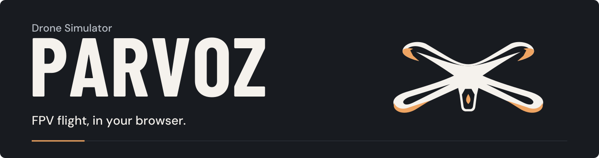

<p align="center">
  <a href="https://parvoz-drone-sim.duckdns.org/">
    
  </a>
</p>

<h1 align="center">Parvoz Drone Simulator</h1>

<p align="center">
  Освойте зависание. Найдите свою траекторию. Летайте с друзьями.<br />
  FPV-симулятор для браузера на ПК: уроки пилотирования, гонки и мастерская дронов.
</p>

<p align="center">
  
</p>

<p align="center">
  <strong><a href="https://parvoz-drone-sim.duckdns.org/">Играть в веб-бету</a></strong>
  &nbsp;·&nbsp; <a href="#скриншоты">Скриншоты</a>
  &nbsp;·&nbsp; <a href="#быстрый-запуск">Быстрый запуск</a>
  &nbsp;·&nbsp; <a href="docs/README.md">Документация</a>
</p>

<p align="center"><a href="README.md">English</a> &nbsp;|&nbsp; Русский</p>

---

## Ваш первый FPV-полёт

**Parvoz** позволяет тренировать FPV-пилотирование в браузере: начните с коротких
уроков, исследуйте локацию в своём темпе, затем попробуйте трассу на время или
гонку с друзьями. Можно начать с клавиатуры или откалибровать совместимый геймпад
либо USB-пульт. Интерфейс доступен на **узбекском, русском и английском**.

В текущем тестовом каталоге: **5 локаций, 30 маршрутов, 5 базовых дронов и 12 уроков**.

| Учитесь и исследуйте | Соревнуйтесь и настраивайте |
| --- | --- |
| **Лётная школа** — зависание, высота, повороты и посадка с пошаговыми заданиями. | **Мультиплеер** — открытые и приватные комнаты на 2–8 пилотов, чат и чемпионаты. |
| **Свободный полёт и фристайл** — аэродром, арена, подземная парковка, лес и загородные маршруты. | **Ангар и настройки** — сохранённые копии дронов, совместимые детали, rates, PID и отклик газа. |
| **Разные способы управления** — клавиатура, Gamepad API и совместимые WebHID-пульты с калибровкой осей. | **Прогресс и повторы** — аккаунты, карьера, рекорды, испытания недели и сохранённые записи полётов. |

## Скриншоты

<table>
  <tr>
    <td width="50%">
      <a href="src/assets/loading/the-green.jpg"></a><br />
      <strong>The Green</strong><br />Открытое пространство и загородные маршруты.
    </td>
    <td width="50%">
      <a href="docs/design/ui-performance-20261018/19-online-final-hangar.jpg"></a><br />
      <strong>Ангар</strong><br />Рассмотрите дрон и выберите свою сборку.
    </td>
  </tr>
  <tr>
    <td width="50%">
      <a href="docs/design/ui-polish-20261015/24-public-workbench.png"></a><br />
      <strong>Мастерская</strong><br />Подберите совместимые детали и настройте дрон.
    </td>
    <td width="50%">
      <a href="docs/design/ui-performance-20261018/09-ru-lessons.jpg"></a><br />
      <strong>Лётная школа</strong><br />Один навык за одно упражнение.
    </td>
  </tr>
</table>

Настоящие кадры игры из разработки и веб-беты. [Источники и даты снимков](docs/presentation/README.md).

## Играть в браузере

**[Откройте Parvoz](https://parvoz-drone-sim.duckdns.org/)** на компьютере в браузере
с поддержкой WebGPU или WebGL2. Локальная установка проекта не нужна.

1. Войдите гостем или используйте аккаунт, чтобы переносить прогресс между компьютерами.
2. В **Настройки → Управление** проверьте клавиши или откалибруйте устройство.
3. Выберите **Лётную школу** для упражнения или **Полёт** для выбора карты и режима.

Карты и дроны скачиваются по мере необходимости. Первый вход на локацию может
занять больше времени, чем повторный. Сохранённые вручную повторы, графика и
калибровка хранятся в текущем браузере; прогресс аккаунта — на сервере.

> **Веб-бета:** надёжность загрузки и плавность кадров ещё дорабатываются.
> Текущий серверный допуск — 20 игроков мультиплеера суммарно по всем комнатам.
> [Опубликованная версия и известные ограничения](docs/ORACLE-DEPLOYMENT.md).

## Основные клавиши

| Клавиши | Действие |
| --- | --- |
| **W / S** · **A / D** · **Q / E** | Тангаж · крен · рыскание |
| **Левый Shift / F** | Увеличить / уменьшить газ |
| **R** | Вернуться к последней пройденной гоночной контрольной точке |
| **C** | Сменить камеру |
| **M** | Переключить Angle, Horizon и Acro |
| **Esc** | Открыть меню паузы |

По умолчанию выбран Acro. Калибровка, WebHID и дополнительные настройки описаны
в [руководстве по запуску и управлению](docs/DEVELOPMENT.md#controls-and-radios).
Сенсорное управление полётом на телефоне пока не добавлено.

## Быстрый запуск

Для участников с доступом к приватному репозиторию. Нужны **Git + Git LFS**,
**Node.js 24+** и браузер с WebGPU или WebGL2.

```powershell
git lfs install
git clone https://github.com/Fayzullo637/ParvozDroneSim.git
cd ParvozDroneSim
git lfs pull
npm ci
npm start
```

Откройте **http://localhost:2567**. В Windows после установки зависимостей также
можно запустить **Play.cmd**. Лаунчер собирает клиент и запускает игровой сервер
с локальным редактором контента. Оставьте окно открытым; **Ctrl+C** завершает запуск.

В локальной сети второй компьютер открывает `http://IP-ХОСТА:2567`.
Внешнему тестировщику отправляйте **[публичную HTTPS-ссылку](https://parvoz-drone-sim.duckdns.org/)**.
[Запуск, проверки, архитектура и работа с контентом](docs/DEVELOPMENT.md).

## Куда развивается проект

Первая аудитория — начинающие FPV-пилоты на ПК, сначала в Узбекистане и
русскоязычных сообществах. Сейчас приоритет — надёжный первый вход, полезные
упражнения для новичков и совместные тренировки небольшими группами.

- Завершить проверки холодного запуска, ангара и первого полёта при разной связи.
- Сократить паузы подготовки сцен и измерить Low при настоящих 1280×720 на целевом ПК.
- Проверить больше USB-пультов и геймпадов на реальных устройствах.

**60 FPS на UHD 620** и **100 одновременных игроков мультиплеера** остаются
неподтверждёнными целями. [Направление продукта](docs/PRODUCT-DIRECTION-20261023.md) ·
[Работа над стабильностью](docs/PUBLIC-STABILITY-20261023.md).

## Навигация по проекту

| Что нужно | Куда перейти |
| --- | --- |
| Запуск, управление и архитектура | [Руководство разработчика](docs/DEVELOPMENT.md) |
| Карты, дроны и исходники Blender | [Работа с ресурсами](docs/ASSET-WORKFLOW.md) |
| Комнаты и чемпионаты | [Руководство по мультиплееру](docs/MULTIPLAYER-ROOMS.md) |
| Версия на сайте и публикация | [Состояние Oracle](docs/ORACLE-DEPLOYMENT.md) |
| Клонирование, сохранение и восстановление | [Работа с GitHub](docs/GITHUB-WORKFLOW.md) |
| Все основные документы | [Навигация по документации](docs/README.md) |

**Технологии:** Three.js, JavaScript, Vite, Node.js, WebSocket и SQLite.

## Контент и авторство

В приватном проекте есть импортированные ресурсы Liftoff для разрешённого
пользователем сетевого теста. Авторы, происхождение и сведения о разрешениях
сохранены в канонических пакетах [`content/`](content/). Право распространения
этих импортов не подтверждено; репозиторий должен оставаться приватным.

Ironworks и ранние сгенерированные карты сохранены в архиве с
[инструкцией ручного восстановления](docs/MAP-ARCHIVE.md) и не входят в активный каталог.
Физическая модель остаётся приближением: настройка по измерениям настоящих дронов
и совместимость конкретных устройств ещё проверяются.

<p align="center"><a href="https://parvoz-drone-sim.duckdns.org/">Играть в Parvoz</a> &nbsp;·&nbsp; <a href="docs/README.md">Открыть документацию</a></p>
