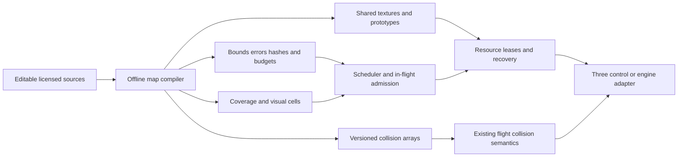

# Parvoz: independent browser 3D technology decision — stage one

**Retrieved 26 October 2026. Research only.** Repository baseline `e17cacb`,
branch `codex/demand-pilots`, content revision `85331b4bc0057c68`.
The [user's complete brief](research/independent-browser-20261026/REQUEST.md)
controls this stage. No game code, dependency installation, asset conversion,
engine migration, browser stress benchmark, production request or deployment
was performed. Documentation and public-source metadata are the deliverables.

Evidence labels: **V** = independently checked documentation/metadata;
**S** = code inspected; **R** = external developer's reported result;
**I** = engineering inference/arithmetic; **H** = experiment still required.
Source inspection is not execution or a compatibility certification.

Decision constraints: $0 operating budget and no paid assets/services; preserve
flight behavior, Kestrel IDs, account/progress data and admission limit **20**.
Ironworks remains retired. Imported content retains its provenance/permission
restrictions. Stage one neither changes nor load-tests production.

The investigation uses current official sources, exact-version package source,
Reddit replies, engine forums, GitHub issues/PRs, Chromium issues, Hacker News,
production interviews, inspectable applications and public benchmark harnesses.
The starting lists were used for discovery, not as proof of capability. An
unavailable page or absent measurement is recorded as a gap, not a negative
performance result. Details are in the [source audit](research/independent-browser-20261026/SOURCE-AUDIT.md)
and [community evidence](research/independent-browser-20261026/COMMUNITY.md).

## A. Strongest findings

### A1. The unit of delivery must change; a renderer swap alone cannot fix it

**S:** Every imported map's spatial/LOD selectors still address **one whole GLB**.
Selecting fewer nodes does not avoid reading/decoding that delivery. The
[fresh read-only catalog audit](research/independent-browser-20261026/repository-audit.json)
finds:

| Map | Whole visual GLB, MB | Collision JSON, MB | GLB alone at 5 Mbps | GLB alone at 20 Mbps |
| --- | ---: | ---: | ---: | ---: |
| Hangar C03 | 270.30 | 27.24 | 432.5 s | 108.1 s |
| Arena | 173.90 | 22.69 | 278.2 s | 69.6 s |
| Pine Valley | 136.09 | 102.99 | 217.7 s | 54.4 s |
| The Green | 263.29 | 138.11 | 421.3 s | 105.3 s |
| Minus Two | 26.34 | 4.52 | 42.1 s | 10.5 s |

MB means decimal 1,000,000 bytes. Times are **I**, ideal identity-transfer
arithmetic at sustained stated bit rates, excluding RTT, contention, collision,
aircraft, decoding and GPU work. They are not measured download times. The
current [static-server source](../server/static-files.js) gzips JSON, not GLB; collision columns are expanded
file sizes and must not be added to a claimed compressed wire-time floor.

**Decision:** produce independently loadable, content-addressed visual cells
and coarse coverage. Treat the runtime as a consumer of a compiled map, rather
than a viewer that opens the full authoring export before flight.

### A2. Pre-baked binary collision is a separate high-priority change

**S:** [Collision loading](../src/collision-preparation.js) preserves cached
downloads by copying the entire buffer into a worker.
[Worker preparation](../shared/collision-preparation.js) then decodes text,
parses/validates JSON and builds the existing packed trees. Worker execution
protects responsiveness; it does not eliminate the expanded text, copy or build.

**I:** ship a versioned, lossless representation of those same prepared arrays,
with source hash, schema/endian checks, bounds and primitive identifiers. First
keep full-map collision coverage, simplifying safety and preserving behavior.
Only later qualify collision streaming for maximum speed, resets and teleports.
No evidence requires replacing the current collision algorithm with another
engine's physics. A changed contact sequence is a rejection condition.

### A3. The renderer question is open, and PlayCanvas deserves a real challenger

**V/S:** Parvoz uses `WebGPURenderer`, TSL and its WebGL2 fallback, not classic
`WebGLRenderer` for the main game. A classic-renderer comparison needs material
and post-processing work. The previous local instancing result removed 432.8 MB
of batch geometry payload but left **5,028,148 triangles / 294 draws** in the
initial Pine view. These are [prior local observations](research/scenery-instance-check-20261026.json),
not new benchmarks or UHD 620 acceptance.

**R:** two inspectable harnesses provide reasons to test PlayCanvas:
[Web Engines Compare](https://github.com/mvaligursky/web-engines-compare) isolates
submission work across three devices; the
[independent Endel harness](https://github.com/endel/webgpu-webgl-benchmarks)
finds much smaller engine differences for instanced workloads than separate
meshes. Both have workload/default-setting limitations. Neither measures Parvoz.

**Decision:** retain the current renderer as the control, compare an engine-only
PlayCanvas adapter on the same compiled cells, and retain Babylon.js as the
second full-engine candidate. Do not wait for an entire speculative rewrite to
find out whether submission cost improves. Do not select an engine from box
benchmarks alone.

### A4. 3D Tiles is usable without a globe, but its LRU is not a browser RAM cap

**V:** the [3D Tiles specification](https://github.com/CesiumGS/3d-tiles/blob/main/specification/README.adoc#coordinate-reference-system-crs)
explicitly permits local Cartesian sites. Use box/sphere bounds, meter units
and an explicit Y-up/Z-up transform; geographic regions are unnecessary.
Earlier uncertainty about whether non-geospatial maps are allowed is resolved.

**S:** `3d-tiles-renderer` supplies traversal, queueing, refinement and disposal,
but registered per-tile estimates do not reserve every transient allocation.
Its material-property estimator also needs adaptation for material arrays and
Parvoz's registered node-graph textures. Shared cross-tile resources require
ownership beyond a per-tile dispose call. See [D1 source findings](research/independent-browser-20261026/SOURCE-AUDIT.md#d1-3d-tiles-renderer-053).

**Decision:** this is the first existing scheduler to compare with Parvoz's
small grid prototype, with explicit in-flight reservations and its actual
texture pool. It is not an automatic memory-safety replacement.

### A5. Progressive loading, bounded residency and cancellation are different

**S:** the exact Needle progressive prerelease has separate LOD URLs, texture
reference tracking and explicit disposal. Its geometry cache can retain resolved
LODs; a readiness wait's cancellation is not transport cancellation. Its queue
defaults are much larger than Parvoz's conservative worker policy. The runtime
is MIT, while the complete authoring/engine route has separate license terms.
See [D2](research/independent-browser-20261026/SOURCE-AUDIT.md#d2-needle-progressive-and-local-build-pipeline).

**Decision:** consider it for progressive individual assets or a locally
qualified pipeline, not as a proven global map-residency manager. Do not upload
restricted maps to a converter. Keep open offline tools as the default compiler.

### A6. Modern WebGPU features matter, but only when the renderer uses them

**V:** Chrome 149–150 introduced
[immediates and stricter transient-attachment rules](https://developer.chrome.com/blog/new-in-webgpu-149-150).
Immediates address tiny per-draw data without another uniform-buffer binding;
transient attachments can help eligible temporary targets. Neither releases
material textures or reduces the map's triangles. These are feature-detected
optimization opportunities, not automatic benefits of changing an API name.

[Compatibility mode](https://developer.chrome.com/blog/new-in-webgpu-146)
also extends reach, initially through OpenGL ES 3.1 on Android; that announcement
does not establish a Windows D3D11/UHD 620 fallback. Non-standard multi-draw
indirect and unsafe flags are excluded from the acceptance baseline.

### A7. Measure rendered motion and ownership, not a persuasive counter

A recent [Babylon forum correction](https://forum.babylonjs.com/t/webgpu-cpu-cost-per-draw-call-in-9-29-9-30-and-which-small-prs-would-you-welcome/64298/11)
explicitly distinguishes page-side FPS, queued GPU completion and displayed
images. Lower JavaScript object counts likewise do not prove lower native GPU
memory. Ordinary timing, instrumented profiling and image/presentation checks
must be separate. There is no target-laptop measurement in this investigation.

## B. Ecosystem comparison

### B0. What is already active in Parvoz

These are **S: repository observations**, not proposed new features:

| Existing path | Already provides | Boundary that remains |
| --- | --- | --- |
| [Asset delivery](../src/asset-delivery.js), [transfer](../src/asset-transfer.js), [byte cache](../src/asset-byte-cache.js) | Shared requests, immutable complete-response Cache API storage, quota/error handling, in-attempt identity Range/ETag recovery; 64 MiB encoded RAM cache | Disk retention and decoded residency are different. An interrupted transfer's in-memory partials do not establish cross-reload partial-file persistence. Whole-map input still has to arrive. |
| [Model loader](../src/asset-loader.js) | Reference-counted loads, bounded idle model cache, Draco/KTX2 and shared Meshopt decoder | Active/pinned models, copied input and GPU staging are outside an idle-only limit. Cached model-node lookup does not change the delivery unit. |
| [Decoder](../src/model-decoder.js), [collision worker](../src/collision-preparation.js), [texture preparation](../src/prepare-scene-textures.js) | Batched/cancellable geometry worker, separate collision work, visible texture preparation before readiness | A worker shifts execution; it does not shrink the data. One oversized view/task or an unprepared later material can still cause peaks/hitches. |
| [Grid scheduler](../src/spatial-map-stream.js), [shared stream textures](../src/shared-stream-textures.js) | Bounded detail selection, eviction/cancellation and shared texture leases in the prototype | This is not yet the active compiled delivery for every full imported map. Its geometry and texture estimates are not a total browser-memory cap. |
| [Low settings](../src/graphics-settings.js) | Shadows, AO, bloom, shafts, clouds, reflections and normal maps already disabled; reduced texture/LOD settings | Turning those effects off again is not a new fix. Acceptance must force actual 1280×720, rather than relying on the preset's 0.65 resolution factor. |

### B1. Renderers and complete engines

Versions below were retrieved on 26 October, not inferred from article dates.
The checked [npm metadata](research/independent-browser-20261026/npm-versions.json),
[additional packages](research/independent-browser-20261026/additional-versions.json)
and [GitHub stable releases](research/independent-browser-20261026/github-releases.json)
record exact publication timestamps and source URLs. “Latest” is not assumed
stable. A release tag is maintenance evidence, not proof of compatibility.

| Candidate | Current checked release/date; license/cost | Backend and architecture | Fit and decision |
| --- | --- | --- | --- |
| Three.js | 0.186.1, 24 Sep 2026; MIT. Parvoz uses 0.180.0. | Classic WebGL2 renderer versus node renderer with WebGPU/WebGL2. Those are distinct render paths. | **Control + isolated upgrade arm.** Lowest gameplay integration cost; preserves current TSL. No automatic map streaming or residency ownership. |
| PlayCanvas engine | 2.23.3, 15 Oct; MIT. Hosted editor plans are separate. | WebGL2/WebGPU, render graph/layers, assets, glTF, instancing. | **First engine challenger.** Keep JS physics/protocol. Shader, terrain and post adapters are substantial. Splat streaming is not triangle-map streaming; Meshopt decoder hooks need qualification. |
| Babylon.js | 9.32.0, 22 Oct; Apache-2.0. | WebGL2/WebGPU, scene/asset containers, thin instances, frame graph, inspector; snapshot paths trade flexibility for retained work. | **Second full-engine challenger.** Broad game tooling; default per-object overhead and cache policies still need measurement. Built-in physics must not replace Parvoz flight. |
| Babylon Lite | `@babylonjs/lite` 1.36.0, 20 Oct; Apache-2.0. | Classless/data-oriented WebGPU renderer with optional features. | **Conditional challenger.** Small bundles and resource-retirement design are interesting. No full 3D WebGL fallback; small vendor parity scenes do not establish map performance. |
| Babylon Lite GL | `@babylonjs/lite-gl` 1.18.0, 19 Oct; Apache-2.0. | A separate WebGL2 micro-engine for effects/sprites and low-level rendering. | **Do not mistake it for Lite's full 3D fallback.** This distinction was verified in the package source/README. |
| Filament | 1.78.1, 21 Oct; Apache-2.0. | C++/WASM PBR renderer; current JS binding explicitly has WebGL2 and a WebGPU backend branch. | **Credible non-JS renderer challenger, later priority.** Requires its material/toolchain and explicit native resource lifetimes. No target benchmark or browser-backend parity certification here. |
| Defold | 1.14.0, 12 Oct; custom Defold License, free game development, restrictions on commercializing the engine itself. | C++/Lua → WASM; collection/resource ownership and Live Update archives; threaded/non-threaded web packaging. | **Credible complete-engine alternative.** Actual web production evidence. Larger simulation/tooling integration cost; a small 2D export is not proof of dense 3D flight performance. |
| Godot | 4.7.2-stable, 18 Aug; MIT. | Native engine → WASM, web Compatibility/WebGL2. Official current web docs still exclude Godot 4 C# export and WebGPU. | **Do not shortlist for this migration yet.** Good editor/LOD tooling, but significant script/material/physics port and no measured advantage for these maps. Not rejected as intrinsically slow. |
| Bevy/wgpu | 0.20.0, 8 Oct; MIT/Apache-2.0. | Rust ECS/render graph, WASM WebGL2 or WebGPU builds; the latter feature overrides the former. | **New-project alternative, high-cost Parvoz port.** Renderer/data architecture merits study; rewrite and two-build fallback qualification are real costs. |
| Galacean | 1.6.13 stable, 29 Dec 2025; MIT. | Web-first TypeScript renderer/game stack; current stable feature support must be qualified separately from experimental branches. | **Watch.** No matched-map/target evidence strong enough to displace the first two challengers. |
| Orillusion | 0.9.2, 31 Jul; MIT. | WebGPU-oriented engine/compute-heavy rendering. | **Watch.** Newer rendering ideas, but no qualified WebGL fallback or UHD 620 large-map result in this review. |
| Needle Engine | `latest` 6.0.0-alpha.7, 12 Oct; numeric stable 5.1.16, 14 Oct. Commercial engine/tool terms separate from MIT progressive runtime. | Three-based authoring/runtime system with progressive glTF pipeline. | **Conditional complete system.** A real pipeline alternative, not a free-runtime license covering every local/cloud tool. Do not silently select its alpha. |
| Unity Web | Unity 6 documentation checked; current stable editor patch not independently established here. Proprietary license with eligibility conditions. | IL2CPP/C++ → WASM; WebGL path, version-specific experimental WebGPU work. Managed and WASM heaps add distinct memory behavior. | **Not a priority migration.** Existing source-game assets do not imply a browser-ready runtime. A full physics/UI/material port is unjustified by current evidence. |
| Wonderland | Current pricing checked; exact engine/runtime release not qualified. Proprietary: free up to $120k annual project revenue, then stated royalties. | C++/WASM core with JS/TS components, web/XR focus. | **Conditional comparison, not a blanket paid-only rejection.** Free entry is real; long-term $0 assumptions and closed-runtime ownership behavior remain unresolved. |
| Flax web / Unreal web ports | Experimental/custom export paths; current exact editor releases not qualified here. | WASM/WebGPU with additional browser/toolchain requirements; Flax web docs warn about unsupported features. | **Do not select now.** Inspectable feasibility exists, but complete export/runtime/platform compatibility and cost need a separate investigation. |

Primary anchors: [PlayCanvas source](https://github.com/playcanvas/engine/tree/v2.23.3),
[Babylon Lite docs](https://doc.babylonjs.com/lite/),
[Lite GL scope](https://raw.githubusercontent.com/BabylonJS/Babylon-Lite/npm-lite-v1.36.0/packages/babylon-lite-gl/README.md),
[Filament JS binding](https://raw.githubusercontent.com/google/filament/v1.78.1/web/filament-js/extensions.js),
[Defold license](https://defold.com/license/),
[Godot web restrictions](https://docs.godotengine.org/en/stable/tutorials/export/exporting_for_web.html),
[Bevy feature selection](https://raw.githubusercontent.com/bevyengine/bevy/v0.20.0/docs/cargo_features.md),
[Wonderland pricing](https://wonderlandengine.com/pricing/),
[Flax web requirements](https://docs.flaxengine.com/manual/platforms/web.html).

### B2. Specialized systems by the bottleneck they actually address

| System | Checked version / license where qualified | What it provides | What it does not provide; decision |
| --- | --- | --- | --- |
| 3DTilesRendererJS | 0.5.3, 18 Sep; Apache-2.0 | Tile hierarchy, SSE selection, queues, cache/disposal hooks; Three/Babylon adapters. | No offline authoring, collision policy or hard total RAM reservation. **First streaming challenger.** |
| Existing Parvoz grid streamer | Local prototype, no new service | Coarse visual coverage, detail selection/cancellation, texture leases and eviction. | Camera-only qualification so far. **Control**, not declared production-ready. |
| Needle gltf-progressive | latest 4.0.0-alpha.8, 15 Oct; highest numeric stable 3.6.2; MIT runtime | Separate mesh/texture LOD URLs, density selection, sharing/disposal. | Global byte admission and transport cancellation need more work; authoring costs separate. **Conditional asset-level candidate.** |
| Needle build pipeline | 3.0.2, 15 Oct; no clear permissive license established from package metadata | Local CLI exists; generates progressive deliveries. | Do not equate runtime MIT with authoring rights. **License-gated trial**, no cloud upload. |
| Cesium engine / loaders.gl | Cesium engine 26.4.0, 1 Oct, Apache-2.0; loaders.gl 4.5.4, 10 Oct, MIT | Geospatial/data traversal and format/loading infrastructure. | More map/viewer machinery than needed for the existing flight renderer. **Compare only if the smaller tile adapter fails.** |
| 3d-tiles-tools | 0.5.4, 15 Jul; Apache-2.0 | Tileset/content conversion and utilities. | Does not replace artistic HLOD generation and gameplay collision compilation. **Offline tool candidate.** |
| glTF Transform + meshoptimizer/gltfpack | 4.5.1, 28 Sep; 1.3.0, 25 Sep; MIT | Existing offline graph/geometry operations, compression, simplification and shared buffers. | Need authored IDs, UV/material/alpha validation and codec compatibility. **Default compiler foundation**, already partly present. |
| Draco | 1.5.9, 16 Oct; Apache-2.0 | Primitive geometry codec; compare size/decode cost on actual cells. | No residency, chunking or universal best-size guarantee. **Codec comparison arm**, not compulsory conversion. |
| KTX Software / Basis | KTX 4.4.2, 4 Oct 2025, Apache-2.0; encoder/runtime revision pairing required | Offline GPU texture delivery, ETC1S/UASTC quality/size choices. | File size does not determine transcode target or resident bytes. **Already-used pipeline to qualify**, not a new universal fix. |
| Core InstancedMesh/BatchedMesh | Pinned Three revision; MIT | Repeated prototypes or heterogeneous geometry submission; spatial bounds and LOD integration. | Neither reduces selected triangles by itself. **Keep measured current solution**; compare alternatives on CPU cost, memory and images. |
| InstancedMesh2 | 0.3.16, 26 Jul; MIT | Instance BVH/culling, visibility, LOD and query helpers. | Published peer range differs from repository main. TSL/backend/source revision must be matched. **Targeted challenger** for CPU culling only if measured hot. |
| BatchedMesh extensions | 0.0.12, 23 Jun; MIT declared by the exact registry version | BVH/LOD/culling extras with backend-specific integration. | Young API and buffer/renderer coupling. **Watch**, not an automatic upgrade to current batching. |
| OptiPixel | Inspected 1.2.0 snapshot; Apache-2.0, PlayCanvas-specific | Worker/software culling, WebGL readback/query choices, WebGPU HZB indirect path. | Different passes/latencies on each backend; not a Three drop-in. **Indoor/occluded-route experiment** if PlayCanvas wins. |
| three-mesh-bvh | 0.9.16, 8 Oct; MIT, declared Three peer >=0.159 | Query accelerator, serialize/deserialize, workers, indirect index option. | It does not define Parvoz's collision semantics. **Optional query reference**, not a reason to replace the packed collision tree. |
| nanite-webgpu / three-virtual-geometry | Experimental; latter 0.1.3, 10 Oct, MIT | Meshlet hierarchy/culling/virtual-geometry research for static meshes. | No qualified browser map residency solution or UHD 620 result; nanite-webgpu explicitly omits streaming/VRAM eviction. **Research reference**, not production selection. |
| Octahedral impostor component | MIT source snapshot `f9429069`, retrieved 26 Oct; private demo version 1.0.0, no qualified stable package | Direction atlas and TSL blending; useful distant-vegetation implementation. | **Compiler-slice candidate.** Inspected cache/bake/material paths need adaptation. Hemisphere, atlas memory, below-canopy views and Low without MSAA are real constraints. |
| R3F/Drei, Threlte, editor wrappers | Not version-qualified finalists | UI/scene composition, interaction and authoring conveniences. | A framework switch does not author HLOD, enforce shared ownership or shrink decoded maps. **No performance-led UI rewrite.** |

Supporting implementation details and links are in the source audit. API wrappers,
ECS adoption and pools can help measured hot paths, but the current evidence does
not identify Parvoz's physics object layout or UI framework as the dominant cost.

### B3. Texture residency, visibility and shader work

Use independently loadable resolution variants and a lease-based texture pool
before attempting software virtual texturing. A normal mipmapped allocation
does not become sparse because the sampler chooses a smaller mip. KTX2
supercompression reduces encoded bytes; BC/ASTC/ETC target, dimensions and mip
chain determine GPU payload. Basis transcoding and the eventual upload are
separate stages. The current Low materials already use reduced mip chains;
converting them to KTX2 again would not be a new architectural improvement.

Chunk-local atlases and shared trim sheets can reduce material variety, but a
giant map-wide atlas can force unrelated regions to remain resident. Preserve
alpha-tested foliage silhouettes, normal/data-map precision, UV boundaries,
texel density and collision surfaces. Treat foliage card thinning/impostors and
solid-building HLOD as separate authoring problems. Meshoptimizer 1.3's voxel
remeshing is interesting for suitable solids, not a blanket forest operation.

For distant vegetation, the [MIT octahedral implementation](https://github.com/ektogamat/octahedral-impostor-component)
is a concrete starting point, beyond a generic instruction to add LOD.
Its current runtime baker/cache should not be copied into a bounded game
unchanged; see D9. Drone views below the canopy invalidate a blanket hemisphere
assumption. Preserve real geometry for near flight/contact and test transitions.

GPU-driven visibility needs a measured win after adding depth/HZB, compute,
indirect arguments and any synchronization/readback. Large open-air views may
offer little occlusion. Hangar interiors are a better trial. A delayed CPU
visibility result must default to visible/unknown at cuts and teleports.
Render bundles save encoding work for suitable static draws, not GPU shading.

Compile/prewarm material variants without falsely treating that as texture or
geometry upload completion. Include course/drone/effect variants created after
startup. Shared VFX materials and bounded pools avoid lifetime-driven pipeline
churn. Parallel shader compile is optional; missing variants, status polling
and first render-object creation can still block. A warmed screenshot is not a
shader-cold flight test.

Count buffer uploads as well as draw calls. A [production racing-game account](https://andersonmancini.dev/blog/threejs-punk-fewer-uploads-faster-frames)
reports substantial redundant instance/uniform uploads. Inspection of Parvoz's
installed r180 finds a relevant uniform-buffer path for groups of <=1,000
instances. That establishes an optimization seam, not its measured cost here;
see D8 before copying a newer-version storage-buffer workaround.

### B4. Delivery, storage, workers, diagnostics and free authoring

| Area | Existing system worth using | Qualification / tradeoff |
| --- | --- | --- |
| HTTP delivery | Existing Oracle, immutable hashed files, ETag/Range/retry; browser Resource Timing | Smaller independently useful cells matter more than a provider move. Resume only validated identity ranges; compression changes byte-offset semantics. |
| Persistent storage | Cache API for complete immutable responses; OPFS for an explicitly designed partial/chunk store | Persistence requests may fail; quotas/eviction/private mode differ. Cross-reload partial resume needs a journal, hash/version validation and atomic completion, not a localStorage “downloaded” flag. |
| R2 | [Standard free tier](https://developers.cloudflare.com/r2/pricing/) has 10 GB-month, 1M Class A, 10M Class B operations; free direct egress | Overages and connected services can cost money. It is not a guaranteed-$0 CDN replacement. Existing hosting remains the first comparison. No account/bucket created. |
| Workers/WASM | Existing geometry/texture/collision workers, transferable buffers and cancellation scopes | Retain only admitted work; a copy made to protect shared cache data is still memory. Moving full-map parse off the main thread does not bound the full-map peak. SAB is not required for ordinary transfer workers. |
| Cross-origin isolation | Optional isolated profiling/threaded build later | COOP/COEP/CORS/CORP affect embeds and asset origins. Decide for an actual feature; do not add headers to production during research. |
| Browser profiling | Chrome traces/heap, [Long Animation Frames](https://developer.chrome.com/docs/web-platform/long-animation-frames), WebGPU Inspector 1.1.1, SpectorJS 0.9.33 | Captures perturb timing. LoAF detects long frames, not every missed 16.7 ms budget. Separate ordinary timing and GPU/debug capture runs. |
| Memory | Resource/ownership ledger, process/shared-GPU observations, [UA memory API](https://developer.mozilla.org/en-US/docs/Web/API/Performance/measureUserAgentSpecificMemory) where available | The API needs secure cross-origin isolation and is implementation-dependent. No in-page number is a universal precise VRAM counter. Include workers, WASM and native/driver caches separately. |
| GPU/presentation | Optional timestamp queries, browser presentation traces and carefully validated OS capture/PresentMon workflows | Queue completion is not display time. Unsupported queries must remain “unavailable,” never zero. Do not compare uncapped software FPS to displayed motion. |
| Free assets | [Kenney asset packs](https://kenney.nl/support), [Poly Haven's public CC0 library](https://polyhaven.com/license), Blender plus existing offline tools | Free assets are not automatically lightweight. Some early-access collections/tools have separate access terms. Save author/link/license and editable sources; do not infer a Sketchfab license from “free.” |

For Parvoz, preserve Liftoff provenance and permission metadata. No cloud
conversion of restricted source content. A future public asset replacement is
its own art/licensing project, not a quiet side effect of changing engines.

### B5. Separate the costs before interpreting a result

This is the measurement/decision map for section F. Several stages overlap;
adding their independent elapsed times is not necessarily total readiness.

| Cost | Candidate mechanism / measurement | What the result cannot establish |
| --- | --- | --- |
| Transfer | Useful cells/coarse coverage, immutable caching and validated resume; actual encoded wire bytes and request timing | Smaller transfer does not prove smaller decoded/GPU resources. Cache API responses can already be expanded. |
| Parse / scene construction | Smaller independent GLBs, shared prototypes/materials, stable indexed node lookup; separate parse and object/clone time | Async parsing alone does not avoid full input, object allocation or main-thread construction. |
| Geometry decode | Qualified Meshopt/Draco cells, bounded worker batches; encoded/output bytes, worker CPU and transfer copies | Codec size wins do not predict final vertex/index memory or selected triangle count. |
| Image decode / transcode | ETC1S/UASTC and resolution variants; actual device target, workers, retained mip data and staging | KTX2 extension support does not certify useful compression on every backend/device. |
| Collision preparation | Existing packed representation pre-baked in a validated binary; copy/decode/parse/build/install marks | Visual streaming does not make collision available; another physics engine is not required by the file problem. |
| Shader / pipeline creation | Fewer material permutations, explicit preparation and bounded lifetime; cold-cache compilation traces | Compiled shaders do not prove uploaded textures or presented smooth motion. Retained programs/modules have a memory cost. |
| GPU upload | Bound admitted data/upload slices; count bytes/calls, first-use uploads and transient allocations | An awaited CPU operation or completed GPU queue is not a displayed frame. A large indivisible upload can still hitch. |
| Time until flight | Coverage, required aircraft/course assets, collision, input and preparation ready; report first controllable flight and stable-play interval separately | Fetch complete, a loader disappearing and a warmed screenshot are different milestones. |
| Steady CPU | Hierarchy/culling, instances, buffer-update behavior and renderer submission; ordinary frame samples plus separate profiling | Lower draw-call CPU does not predict a GPU-bound view's final FPS. |
| Steady GPU | Useful LOD/HLOD/impostors, alpha/fill cost, resolution and net visibility-pass cost; qualified GPU timing | Fewer draws do not mean fewer triangles, texture samples or shaded pixels. |
| Tails / responsiveness | Long frames, first effects, dynamic materials, boundary crossings and map switches; retain raw outliers | Average FPS can hide stalls. In-page callbacks and captured distinct images need different validation. |
| Long sessions / transitions | Explicit live ownership, shared leases, retiring generations and soak tests; categorized plateau and switch peak | A resource counter or collected JS wrapper is not precise native/GPU-process memory. |

Track encoded RAM cache, decoded arrays/images, JS heap, worker/WASM memory,
GPU allocations, browser/driver process footprint and disk storage separately.
Avoid adding shared ArrayBuffer views as independent allocations, or adding
estimated GPU bytes to a process number that already includes them. Unknown
driver allocations stay unknown. A budget needs both steady ownership and
temporary overlap, including an old map that remains alive while the next loads.

## C. Community evidence

The [community appendix](research/independent-browser-20261026/COMMUNITY.md)
records original dates, hardware/version, reported result, reproduction quality,
replies/status and project relevance. It distinguishes independent experiments
from repeated posts by the same team, vendor benchmarks and unverified claims.
Conflicting results are retained. No vote count or screenshot is used as proof.

## D. Deep evaluation of finalists

The [source audit](research/independent-browser-20261026/SOURCE-AUDIT.md)
contains exact-version code paths and the boundaries of each inspection:

1. 3DTilesRendererJS: Cartesian fit, admission/byte estimates, abort paths,
   deferred parse completion, shared texture disposal and integration seams.
2. Needle: real LOD files versus cached residency, readiness cancellation versus
   transport, concurrency, per-resource lifetimes and authoring-license separation.
3. PlayCanvas: buffer-view decode hook, whole-container loading, asset unload,
   pipeline creation and backend-specific visibility work.
4. Babylon.js/Lite: current teardown fix versus application streaming cache
   policy; Lite's allocation references, fenced retirement, full GLB loading and
   separate GL micro-engine.
5. Filament/Defold/Bevy: what native/WASM architecture can change and what must
   still be explicitly integrated; documented browser/backend limits.
6. Current Three instance uploads and an MIT octahedral impostor implementation:
   source-qualified ways to reduce CPU transfer work and selected forest geometry.

## E. Recommended architecture options

### E1. Improve the current whole-map Three architecture

Keep the current renderer, finish resource accounting, pre-bake the existing
collision trees and reduce selected Low geometry/material work. This is the
lowest-integration path and can improve CPU peaks and frame cost. It still
leaves the visual whole-GLB transfer/parse dependency. It is a useful control
and interim improvement, not the complete large-map solution.

### E2. Compiled maps plus a specialized streaming system — recommended next

Use existing glTF Transform/meshoptimizer/KTX tooling around a deterministic map
compiler, keeping editable sources and gameplay identities intact. Emit:

- A small bootstrap/distant coverage package and independently useful cells.
- Parent/child HLOD, geometry bounds, measured error and replacement semantics.
- Shared content-addressed texture/prototype resources with explicit leases.
- Encoded, decoded CPU and target-format texture estimates, including unknowns.
- Versioned pre-baked collision arrays, initially retaining full-map coverage.
- Provenance, hashes, stable node/primitive aliases and codec/schema versions.

Compare `3d-tiles-renderer` with the existing grid control on exactly those
deliveries. Prefer the existing library if it meets the behavior and cost gates;
keep custom scheduling limited to demonstrably missing behavior. The compiler
must not be coupled to a Three scene graph, so the same cells support an engine
comparison. 3D Tiles already has Three/Babylon adapters; a PlayCanvas rendering
adapter is additional work, not an implied built-in feature.

Budgets must account for **pinned working set + encoded in-flight + decoded
staging + pending upload + retained old scene**. Avoid admitting a cell merely
because the loaded-cache counter is below its maximum. An indivisible oversized
cell must fall back to coarser coverage or fail packaging; do not silently exceed
the low-device budget. GPU submissions already in flight can delay reclamation.

Use velocity-aware look-ahead and retention hysteresis. A starting prefetch
distance can be derived from speed × measured fetch/decode/prepare latency,
with a margin; it must then be checked on reversals and resets. Camera visibility
alone is insufficient for collision safety. Do not change flight rules to hide
a missing collision cell. Preserve coarse visuals until a complete replacement
is usable and its materials/uploads are prepared.

### E3. Engine migration

Do not reject migration; make it a competing measured design. Build a minimal
PlayCanvas render adapter first, Babylon.js second if justified, and a Lite
arm only if WebGPU coverage/feature requirements permit. Filament is a credible
later native-renderer comparison. Defold/Bevy/Godot require a much larger app
and simulation boundary port; that cost needs evidence beyond a small empty
export or unrelated 2D game.

Reuse the same visual cells, camera replay, surface quality and JS flight state.
Preserve Kestrel IDs, protocol/admission and accounts. Porting standard glTF
materials is not the same as porting native terrain blends, sky/reflections,
post effects, inspection and recovery. Start with a visually matched render
slice, then one complete flight/hangar/course path before planning a rewrite.

**What changes this recommendation:**

- Migrate if a challenger meets the actual Low/UHD 620 frame target where the
  control fails, without trading away image quality, time-to-fly, memory,
  collision parity, WebGL fallback needs or $0 constraints.
- A proposed practical significance gate is at least 20% lower end-to-end median
  frame time with improved tails across repeated matched routes. This is a
  proposed experiment rule, not a user-approved requirement or measured result.
- Keep the current renderer if the compiler/LOD change resolves the target and
  challengers add cost without a material benefit. Keep measuring GPU and CPU
  separately; submission wins may not change a fill/geometry-bound view.
- Reject a streaming library for this integration if its byte/cancellation/
  shared-ownership semantics cannot be adapted without breaking the gates.
  That is not evidence that all uses of the library are defective.

## F. Prioritized decisive experiments — proposed, not executed

### Common protocol

Use the real i5/UHD 620 laptop, known power/thermal state, fixed browser/driver,
Low, actual 1280×720 framebuffer and adaptation off. Record backend, hardware
acceleration, device limits and optional features; no unsafe browser flags for
acceptance. Other hardware remains exploratory. Reuse deterministic physics
input/camera routes and stable seeds; count every pass consistently.
Acceptance is **60 FPS, median frame time <=16.7 ms and 1% low >=50 FPS** on
that target laptop. Preliminary Low production budgets remain 150k–300k visible
triangles, <=250 draws and <=256 MiB mipmapped textures; those are constraints,
not guarantees of the frame target. This stage does not claim to meet them.

Keep three run classes separate: ordinary frame/load timing without captures;
instrumented CPU/GPU/memory diagnosis; fixed-pose visual/presentation checks.
Export frame IDs/timestamps where feasible. Define 1% low as 1000 divided by
the mean of the slowest ceil(1% × N) frame times, not simply reciprocal p99.
Retain stalls rather than trimming them from the distribution.

Cold means a separate test profile with empty HTTP/app caches and documented
shader-cache state; warm is a repeat in that profile. Also test assets-warm /
shader-cold explicitly. Use at least five cold and ten warm loads for candidate
comparisons, randomized/interleaved order, and retain raw samples. No deletion
of the user's ordinary browser data and no production traffic/load test.

| Priority / experiment | Inputs and arms | Measurements | Decision / rejection condition |
| --- | --- | --- | --- |
| P0: freeze the control and validate measurements | Current local build; small Minus Two, Pine, Green; normal browser pacing | Per-stage marks, bytes/caches, CPU submission, optional GPU queries, displayed-motion evidence, resource ledger | Counter/backend/image mismatches invalidate comparison. This does not block paper/source research already completed. |
| P1: pre-baked collision representation | Same authored colliders; current JSON-worker build versus versioned prepared binary, first full-map | Expanded/encoded bytes, copied bytes, parse/build/install CPU, peak worker/main memory, contact replay | Require identical contact outcomes/IDs and corrupt/version rejection. Adopt only if load/peak cost improves; do not quantize precision blindly. |
| P1: geometry/texture compiler slice | Same chosen Pine sector, existing LOD versus useful cell/HLOD outputs; distant octahedral foliage arm | Selected triangles, geometry bytes, alpha overdraw proxy, atlas bytes, UV/material/normal parity, above/below-canopy poses and LOD transitions | Fail on silhouette/contact-space changes outside agreed art tolerance, missing nodes or no useful reduction. Aim at the user's Low budgets, not a fixed simplifier ratio. |
| P2: streaming scheduler | Same compiled Minus Two/Pine slice: current whole-map, grid control, 3D Tiles | Bytes before input-ready/collision-ready, total refinements, peak reservations, errors, cancellations, revisit hits, queue/upload slices | Proposed gate: at least halve cold time-to-fly without exceeding the control's peak memory; zero coverage holes. A configured half-working-set test must keep coarser coverage and stay bounded. |
| P2: texture variants | Representative albedo/normal/ORM/alpha/atlas cells, current versus ETC1S/UASTC/resolution variants | Wire bytes, transcode target and ms with 1/2/4 workers, retained CPU data, mip payload, upload long frames, images | No blanket codec winner. Reject visible normal/alpha damage, worse readiness or unbounded texture overlap. Do not claim an encoded-size win as VRAM saving. |
| P3: renderer/engine comparison | Current r180 node renderer WebGL2/WebGPU; isolated r186.1; PlayCanvas; optionally Babylon/Lite | Both separate-mesh and equivalent instanced arms, identical effects, CPU/GPU/frame tails, startup, memory, shader-cold behavior | Same visual work and real framebuffer required. Meet actual target, then apply proposed significance/cost gate in E3. No winner from default cube settings alone. |
| P3: unchanged instance-upload cost | Real scenery groups <=1,000 instances; stock r180, isolated upgrade and qualified versioned attribute/storage path | `writeBuffer` calls/bytes by pass, CPU time, moving-LOD correctness, normals/colors, images; ordinary timing separately | Require fewer redundant bytes and net frame-time benefit with matching images/LOD. A storage-only WebGPU arm is not automatically an acceptable WebGL2 fallback. |
| P3: compilation/upload preparation | Current preparation versus explicit material/permutation and upload coverage | Ready gate, first 60 s frame tails, compile/upload events, dynamic effect/quality/camera changes | Proposed goal: no post-ready >50 ms preparation hitch on the replay without adding more than 2 s readiness. Investigate single uninterruptible work units rather than merely increasing warmup. |
| P4: bounded ownership / soak | Ten A→B→A transitions, then 90-minute flight/revisit loop | Expected lease/resource plateau after warmup, JS/WASM/native/GPU categories, in-flight and switch peaks, slope and retained objects | Fail on unbounded live ownership or progressive frame degradation. OS memory alone is insufficient; require attribution. Proposed limits must be calibrated to the actual device, not invented as a universal MB cap. |
| P4: delivery/cache/resume | Local throttled 5/20/100 Mbps, latency/loss; cold/warm/offline/restart/quota cases | Actual wire bytes, Range/ETag correctness, partial persistence, cache hit source, request count, duplicate copies | Completed unchanged chunks must not be re-fetched; corrupted/changed partials restart safely. Quota/eviction must degrade gracefully. Keep existing $0 host unless delivery measurements justify another option. |
| P5: culling/low-level WebGPU | Only after CPU/GPU diagnosis; indoor Hangar and open Pine separately | BVH cost, HZB/depth cost, readback latency, indirect calls, optional immediates/transient targets | Reject negative net frame-time or extra pop-in at camera cuts. No non-standard multi-draw requirement. Leave physics unchanged. |

Routes must include slow orbit, maximum-speed straight flight across multiple
cells, out-and-back revisits, sharp reversals at boundaries, reset/teleport,
hangar→flight, quality switching and A→B→A transitions. Measure input-ready and
first stable-play window separately: successful fetch/parse is not flight,
and adding a forced three-second observation window must not be hidden in a
single readiness number.

## G. Remaining uncertainty and adoption boundary

**Verified now:** repository structure/current renderer; public package/tag
versions and the stated licenses where cited; monolithic model references and
expanded collision sizes; Cartesian 3D Tiles fit; the inspected code paths and
documented backend limits. Previous local geometry/worker/file results retain
their original methods and hardware limits; they were not rerun here.

**External reported:** all community FPS/memory improvements, vendor parity
figures and production testimonials. Some have code/raw data, some do not.
The community appendix records corrections and avoids independent-count inflation.

**Inferred:** the compiler/ownership boundary is a higher-value architecture
change than another codec checkbox; full GLB transfer floors; pre-baking the
current collision representation should remove repeated parse/build work.
Those do not identify the actual UHD 620 CPU/GPU bottleneck.

**Still hypotheses:** engine winner, target-device WebGPU availability/benefit,
safe working-set budget, HLOD art thresholds, cold/warm time-to-fly gains,
net occlusion benefit, total memory savings, long-session stability and practical
shader-cold coverage. No target FPS claim is made.

Not fully audited: every migration guide/feature in every engine, closed runtime
internals, every browser/driver, every tool's commercial contract, and all
source paths of broad watch-list projects. GitHub REST rate limiting constrained
further metadata expansion; exact-version raw files and npm artifacts were used
for the core finalist inspection. Missing evidence remains explicit.

**Stage-two starting decision:** preserve the simulator, compile useful visual
cells plus the existing collision data, compare 3D Tiles with the grid control,
and run a matched PlayCanvas renderer challenger. This is a concrete next
architecture decision, not authorization to implement it during stage one.
