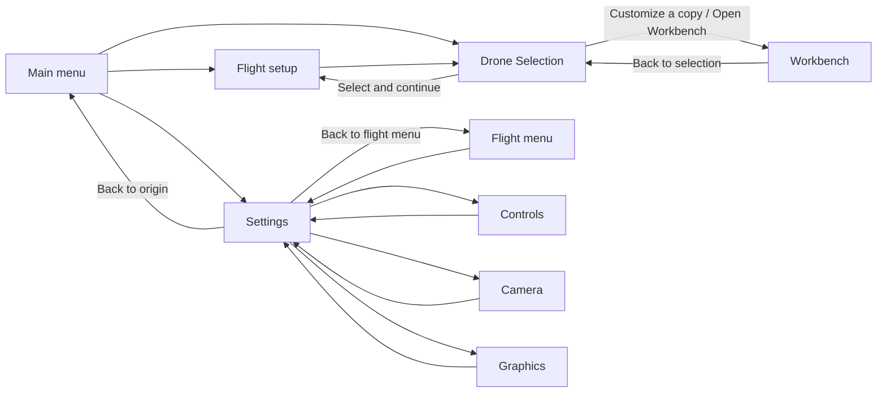

# UX: выбор дрона, предпросмотр и настройки

Дата: 2026-10-04.

## Исследование

Это исследование официальных интерфейсных паттернов и проверка задач в нашей игре. Пользовательское тестирование с отдельной группой участников не проводилось.

| Источник | Наблюдение | Решение для нашей игры |
| --- | --- | --- |
| [VelociDrone Desktop Manual — Model Selection и General Menus](https://www.velocidrone.com/desktop_manual) | Выбор модели, её редактирование и подтверждение перехода к маршруту имеют отдельные действия. Options группирует настройки по назначению, настройка контроллера также выделена. | Самостоятельный Drone Selection с предпросмотром, визуальным набором моделей и явным подтверждением. Settings открывает категории, а редактирование сборки остаётся в Workbench. |
| [Liftoff — Update 1.6.5](https://www.liftoff-game.com/news/update-165-released) | Разработчики расширили меню выбора, чтобы показывать больше дронов. | Нижняя горизонтальная полоса с миниатюрами настоящих сборок позволяет одновременно сравнить несколько моделей, а центр экрана отдан выбранному дрону. Это наша композиция, а не утверждение о точном расположении элементов Liftoff. |
| Проверка прежнего интерфейса на 1280×720 | Вертикальный список и описания находились в одной панели. Настройки фактически открывали Controls; Graphics имел отдельный вход. Верхний набор Fly/Hangar/Settings/Explore повторял главное меню. | Разделить задачи, убрать повторяющуюся навигацию и сделать возврат зависимым от того, откуда открыт экран. |

## Единая модель взаимодействия

- **Выбор:** карточка меняет предпросмотр. Метка In use показывает фактически выбранный для полёта дрон. Use drone подтверждает выбор; из Flight setup кнопка Select & continue возвращает к выбранной карте, режиму и маршруту.
- **Кастомизация:** оригинал открывается через Customize a copy; создаётся отдельная модификация. Сохранение сборки и выбор для полёта остаются разными действиями.
- **Предпросмотр:** горизонтальное и вертикальное перетаскивание вращает камеру вокруг неподвижной модели. Колесо меняет масштаб. Замена дрона или деталей сохраняет выбранную позицию; смена компоновки сохраняет направление и масштаб, подгоняя кадр к доступной области.
- **Настройки:** Controls отвечает за радио, калибровку и режим управления; Camera — за FPV/Chase, наклон и FOV; Graphics — за существующие настройки качества. В меню паузы один вход Settings. Выход из категории возвращает в Settings, затем — в исходное меню.
- **Навигация:** постоянная верхняя панель Fly/Hangar/Settings/Explore убрана. Каждый экран использует своё действие возврата; Esc следует тому же пути. Сверху остаются бренд, помощь и профиль.

## Ангар

Сверху — заголовок и возврат. В центре — большая живая 3D-модель; справа — название, класс, параметры и действия. Снизу — фильтры All/Original/Modified и карточки с миниатюрами фактических моделей, цветов и деталей. Карточки прокручиваются горизонтально; стрелки доступны при переполнении.

Кнопки выбора и кастомизации постоянно видны. При недостатке высоты прокручиваются сведения о дроне. Заблокированный дрон можно рассмотреть, но его нельзя использовать или кастомизировать. Пустой Modified предлагает перейти к Originals, без скрытого выбранного оригинала.

Текущий ангар: [drone-selection.jpg](screenshots/drone-selection.jpg).

## Проверка

- `npm test`: **128 passed, 0 failed**. Включены четыре новые регрессии орбиты: неподвижная цель, сохранение позиции при замене модели/детали, подгонка после изменения компоновки и ограничения вертикального угла/масштаба.
- `npm run build`: успешно; миниатюры используют Three.js и настоящий каталог игры.
- Лично в Browser на 1280×720 проверены пять миниатюр, фильтры, видимость действий, предпросмотр заблокированного Viper R и запрет его выбора/кастомизации.
- На 1920×1080 проверены DOM-границы: модель, правая панель и полоса дронов остаются внутри окна, нижняя граница полосы — 1052 px. После проверки восстановлен обычный размер окна.
- Реальное перетаскивание в Hangar и Workbench меняет положение сцены вокруг неподвижного дрона. Замена Kestrel 5 на Swift 3 сохраняет ракурс. Замена Guarded на Carbon X сохраняет положение стола, света и инструментов: [до](screenshots/orbit-before-part.jpg), [после](screenshots/orbit-after-part.jpg). Черновик возвращён к исходной сборке.
- Select & continue выбрал Swift 3 и вернул в Race / Mossline / Needle Thread. После проверки выбран исходный Kestrel 5.
- Settings → Controls/Camera/Graphics и возвраты кнопкой/через Esc проверены в Browser. Обзор настроек: [settings-hub.jpg](screenshots/settings-hub.jpg).
- Проверен путь Flight menu → Settings → Graphics → Settings → Flight menu → Continue: время полёта после продолжения соответствует моменту паузы. В More главного меню остались Weekly challenge и Replays. Ошибок в консоли нет.

## Дополнительный контент

Миниатюры формируются из той же сборки, что и центральный предпросмотр; отдельные картинки разработчику не требуются. Кэш учитывает сборку и ревизию каталога. При уходе с экрана генерация отменяется; загрузившиеся позже ассеты и временный графический контекст освобождаются.
